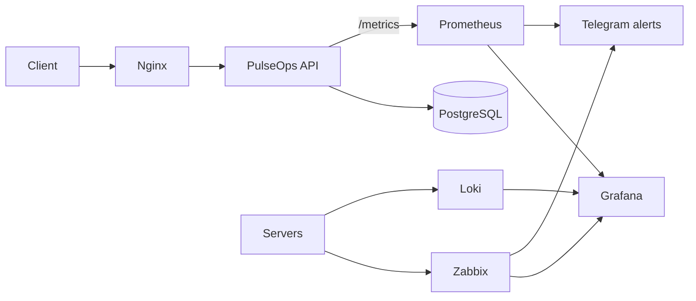

# PulseOps

**Self-hosted uptime & infrastructure monitoring platform with a fully automated CI/CD pipeline.**

**Платформа моніторингу доступності та інфраструктури з повністю автоматизованим CI/CD.**

[English](#english) · [Українська](#українська)

---

## English

### Overview
PulseOps continuously checks the availability and response time of websites and APIs,
and combines this with host-level infrastructure monitoring. Application metrics are
collected by Prometheus, servers are monitored by Zabbix, dashboards live in Grafana,
and incidents are delivered to Telegram in real time. Everything is containerized and
deployed automatically through a CI/CD pipeline.

### Features
- **Uptime checks** – register sites via REST API, probe them on a schedule, track status and latency
- **Hybrid monitoring** – Prometheus for service metrics, Zabbix for host-level monitoring
- **Dashboards** – ready-to-use Grafana boards for uptime, latency and server health
- **Alerting** – instant Telegram notifications on downtime and recovery
- **Centralized logs** – Loki for log aggregation next to metrics
- **Automated delivery** – every change is built, tested and deployed through CI/CD
- **Infrastructure as code** – reproducible environment with Docker Compose and Ansible

### Architecture
(see diagram below)

### Tech stack
| Area | Tools |
| Application | Python, REST API, PostgreSQL, Nginx |
| Containers | Docker, Docker Compose |
| Monitoring | Prometheus, Grafana, Loki, Zabbix |
| Automation | GitHub Actions, Ansible |
| Alerting | Telegram Bot |

### Roadmap
- [x] Repository and project structure
- [ ] PulseOps API and database
- [ ] Containerization (Docker Compose)
- [ ] Prometheus and Grafana dashboards
- [ ] Zabbix integration
- [ ] Loki log aggregation
- [ ] Telegram alerts
- [ ] CI/CD pipeline
- [ ] Ansible deployment
---

## Українська

### Огляд
PulseOps безперервно перевіряє доступність і час відповіді сайтів та API,
доповнюючи це моніторингом інфраструктури на рівні хостів. Метрики застосунку збирає
Prometheus, за серверами стежить Zabbix, дашборди будуються в Grafana, а інциденти
миттєво приходять у Telegram. Усе контейнеризовано та розгортається автоматично через CI/CD.

### Можливості
- **Перевірки доступності** – реєстрація сайтів через REST API, регулярні перевірки, статус і затримка
- **Гібридний моніторинг** – Prometheus для метрик сервісів, Zabbix для моніторингу хостів
- **Дашборди** – готові борди Grafana для доступності, затримок і стану серверів
- **Алерти** – миттєві сповіщення в Telegram про падіння та відновлення
- **Централізовані логи** – Loki для агрегації логів поруч із метриками
- **Автоматична доставка** – кожна зміна збирається, тестується та розгортається через CI/CD
- **Інфраструктура як код** – відтворюване середовище на Docker Compose та Ansible

### Архітектура
(діаграма нижче)

### Стек
| Напрям | Інструменти |
| Застосунок | Python, REST API, PostgreSQL, Nginx |
| Контейнери | Docker, Docker Compose |
| Моніторинг | Prometheus, Grafana, Loki, Zabbix |
| Автоматизація | GitHub Actions, Ansible |
| Алерти | Telegram Bot |

### Roadmap
- [x] Репозиторій і структура проєкту
- [ ] PulseOps API та база даних
- [ ] Контейнеризація (Docker Compose)
- [ ] Prometheus і дашборди Grafana
- [ ] Інтеграція Zabbix
- [ ] Логи через Loki
- [ ] Telegram-алерти
- [ ] CI/CD пайплайн
- [ ] Розгортання через Ansible

---

## Architecture / Архітектура

h
